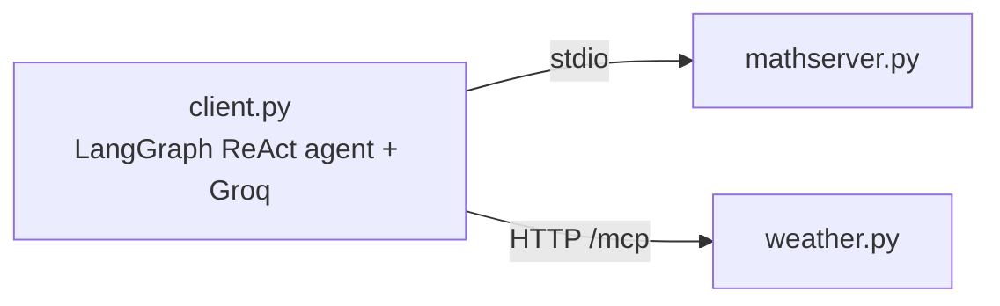

# MCP + LangGraph Demo

> **Note:** This is a **learning project**: my first time working with **MCP (Model Context Protocol)**.
> It is intentionally small and is not production software.

A LangGraph agent (Groq LLM) that uses tools served by two small MCP servers built with **FastMCP**:

| Server | File | Transport | Tools |
|---|---|---|---|
| Math | `mathserver.py` | `stdio` (client starts it automatically) | `add`, `multiply` |
| Weather | `weather.py` | `streamable-http` (you start it, port 8000) | `get_weather` |

The weather tool is a **stub**: it returns a fixed sentence and calls no real weather API.
It exists to show how a second, separately running server plugs into the same agent.



## What I was learning

- Writing MCP servers with `FastMCP` and `@mcp.tool()`
- The two transports: `stdio` (client spawns the server) vs `streamable-http` (separate process)
- Loading tools from several servers with `MultiServerMCPClient`
- Giving those tools to a prebuilt LangGraph ReAct agent
- Why tool docstrings matter: the LLM reads them to decide which tool to call

## Setup

```bash
cp .env.example .env      # then put your real GROQ_API_KEY in .env
uv sync                   # or: pip install -r requirements.txt
```

## Run (two terminals)

```bash
# terminal 1: weather server
python weather.py

# terminal 2: agent
python client.py
```

If the weather server is not running, the client exits with a message telling you to start it.

The default model is `openai/gpt-oss-120b`. Change it with `GROQ_MODEL` in `.env`
(for example `qwen/qwen3-32b`). Make sure the model supports tool calling.

## Known limitations

- The weather tool is a stub and ignores real conditions.
- No retries, auth or error handling beyond the connection check.
- Uses `create_react_agent` from `langgraph.prebuilt`, which is deprecated in newer
  LangGraph in favour of `langchain.agents.create_agent`. It works today.

## Possible next steps

Replace the weather stub with a real API, add more tools, migrate to `create_agent`.
